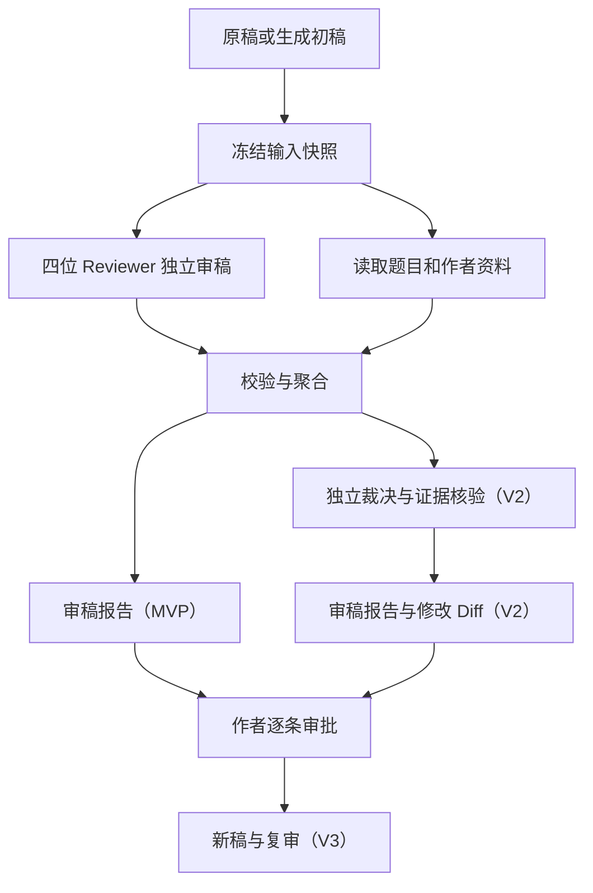

# 申请文书 Agent 构建方案

这个项目处理研究生申请中的 SOP、Personal Statement 和短答。第一版从已有文稿开始，把每条建议定位到原文或申请要求，生成一份可用于人工决策的审稿报告。后续增加事实核验、独立裁决，以及根据已确认素材生成初稿。

审稿围绕原文依据、修改收益和作者声音展开。每条意见回答这句话是否有证据、改动能解决什么问题、改后是否还像作者本人。报告可以建议保留原文或先向作者核实。

## 工作流与权限

| 组件 | 可见信息 | 可执行动作 |
| --- | --- | --- |
| Draft Writer（后续） | 申请要求、作者确认的素材、写作偏好 | 生成候选初稿，标出素材引用和待补信息 |
| Orchestrator | 输入快照、运行配置、执行状态 | 封装请求、调度、校验、聚合和生成报告 |
| 四位 Reviewer | 相同的待审文本、申请要求和必要的写作偏好，各自的职责说明 | 提交定位到原文的问题、证据与候选建议 |
| Independent Adjudicator（V2） | 输入快照、去掉模型名称的意见、事实核验结果 | 逐项提出处理意见并写明依据 |
| 作者 | 原稿、审稿意见、引用证据、候选修改、运行完整性 | 批准、拒绝或搁置建议，决定何时形成新稿 |

编排器由程序实现。每位 Reviewer 通过一次独立的无历史请求审稿，提交前看不到其他 Reviewer 的回答、作者的生成提示或模型对初稿的自我评价。所有 Reviewer 开始前冻结同一份输入，个别 Reviewer 失败时记录该角色缺席。MVP 可以用同一模型执行四种角色，得到上下文隔离的评审。模型之间的判断相关性由 V3 的对照实验衡量。

V2 可以用运行 ID、输入哈希、角色和提示版本为每次任务生成幂等键，补跑前核对快照并保留每次尝试的状态。暂时的网络错误适合有限次数重试，结构或引文校验失败应记录具体错误。配置超时和并发上限，允许在预算耗尽时输出明确标记的部分报告。

### Reviewer 职责

| 角色 | 优先检查 | 建议保留的情形 |
| --- | --- | --- |
| Structure | 主线、段落功能、动机到行动的衔接、重复内容、推理缺口 | 个人经历虽短，但对后续研究问题有清楚的铺垫 |
| Admissions | 题目是否答全、申请动机和项目匹配的具体程度、要求覆盖 | 一句具体的研究问题已足以解释选校动机 |
| Language | 用词、句法、流畅度、语域、作者声音 | 表达略有个人习惯，但清楚且与作者偏好一致 |
| Skeptical | 贡献归属、量化指标、因果、夸张和未经支持的结论 | 说法的程度与当前证据相称 |

每个角色可以返回空问题列表。每条问题应给出局部理由和能改变判断的证据。对于题目遗漏，引用最接近相关要求的原文并在理由中指出条款。对于修改后几乎没有收益的措辞偏好，可以用保留意见说明原句的作用。

## 数据契约

| 对象 | 内容与约束 |
| --- | --- |
| 输入快照 | 原稿、申请题目和限制、写作偏好。保存文本哈希与版本。段落编号和原文引句共同定位，处理同一短语在多段重复的情况。 |
| Reviewer 返回 | 使用统一 JSON Schema。每条意见含意见类型、类别、严重程度、原文锚点、理由、建议动作、可为空的替代文本和证据 ID。原文锚点由段落 ID 及在该段中唯一出现的逐字引句组成。 |
| 聚合问题 | 包含稳定的本次运行问题 ID、支持该问题的角色、不同意见、建议和处理状态。保存原始意见，便于从聚合结果回溯。 |
| 事实主张（V2） | 标记原文位置、主体、动作或结果、日期或数值及单位、适用范围、关联证据和核验状态。区分个人贡献、团队成果与作者本人对经历的解释。 |
| 审批与修改 | 每条批准记录绑定运行和原稿版本，指出所批准的建议。生成新稿前再次核对版本和原文位置。 |
| 运行记录 | MVP 将审稿结果、Markdown 报告和候选 Diff 分别写入 `run.json`、`report.md` 和 `proposed.diff`。报告标题采用英语。审批后在新稿旁记录回执。V2 补齐提示、规则和证据版本，串联裁决、审批、产物哈希和父版本。 |

模型的结构化输出进入应用后，仍需经过本地数据校验。MVP 检查锚点和引用 ID 的有效性。证据 ID 的存在只表明系统收到了对应材料。V2 才核实材料能否支持相关主张。动手修改前再次确认审批对应当前输入，并检查多条改动是否重叠。输入变化后重新审稿和审批。所有获批的改动都通过校验后再写新稿。

### 证据、严重程度与结论

证据的权重取决于它能回答的问题。例如，最新的官方题目提供字数限制，团队报告说明共同工作，个人贡献仍需要作者说明或能显示署名和行为的材料。

| 证据 | 适合支持的判断 | 核对内容 |
| --- | --- | --- |
| 申请方官方要求 | 项目名称、题目、时间、字数、提交要求 | 记录校区、项目、申请周期、来源和获取日期 |
| 作者确认或原始记录 | 个人经历、时间线、分工、工作成果 | 确认归属范围，区分自述、原始材料和第三方证明 |
| 原稿引句 | 结构、语法、用词、当前有没有解释某项内容 | 引文定位及上下文，涉及全篇时列出对应段落 |
| Reviewer 推断 | 读者可能产生的疑问、表达的潜在歧义 | 记录假设，提出中性问题或可回退的建议 |

V2 用「已支持」「部分支持」「来源冲突」「待补证据」记录事实核验结果。数据覆盖不足时结论应限定适用范围，例如「已有记录支持作者实现了界面，推荐算法的个人分工仍需补证据」。对于候选修改中新增的数值、职责、学校资源或发表信息，同样要求能追溯到证据。

为来源分配稳定 ID，在记录中保存材料类型、出处、日期、适用范围、片段和内容哈希。核验报告引用可以复读的具体片段。若两条官方发布信息冲突，系统先检查校区、申请周期和页面日期，再保留冲突并提请人工确认。联网查证应针对用户允许的公开项目资料，避免在检索查询或第三方网页中带入私人稿件内容。

用以下三个等级确定处理顺序。

- **必须处理**包括有明确来源的硬性要求违反、有证据的事实冲突，以及会影响已批准改动安全的版本问题。
- **建议修改**包括影响理解或可信度的缺口，例如未解释个人行动与成果之间的联系。
- **可选调整**包括有具体收益的语言偏好。作者可以在审批中选择保留。

一个 Reviewer 引用正确的参考条款即可指出硬性问题。几个 Reviewer 给出相同推测时，报告显示意见集中到同一点，事实核验仍按证据记录。词数等规则只在算法和计数口径确定时可自动判定。题目未说明时记录采用的算法，把边界案例留给作者核对。

## 聚合、裁决与修改

1. **聚合。** MVP 以相同原文位置、类别、意见类型、动作和候选替换归并问题。至少一条意见涉及改写时，重叠且无法同时应用的意见标记为分歧。报告显示哪些 Reviewer 提出某问题及角色执行完整性。某角色未评论一个锚点属于缺少表态。部分审稿失败仍可出报告，并标记审稿不完整的角色和暂不可审批的状态。
2. **识别分歧（V2）。** 区分解释不同、事实结论相反、处理动作相反和候选修改互相覆盖。对齐依据允许人工复核。将看法隐藏与 Reviewer 身份隐藏区分开，裁决时保留职责视角，模型名称和生成来源不进入裁决请求。
3. **独立裁决（V2）。** 裁决使用单独请求和独立提示，可指定另一模型。裁决方先从原文和来源记录自己的观察，随后读取去掉模型名称的意见与建议。按条输出采纳、保留、请求核实或交由作者决定，附原文锚点和证据引用。证据不足或作者声音存在取舍时允许搁置。对报告做交换意见顺序及隐藏支持人数的测试，观察决定是否随排序改变。
4. **展示候选修改。** 报告列出原文、候选建议和理由。MVP 仅允许作者批准 Language Reviewer 提出的低严重程度且无证据引用的合格替换，并据此另存新稿。候选 Diff 可在审批前查看。V2 为每项可执行候选附上 Diff、影响的事实、上下文和字数。
5. **记录决策。** 多项建议触及同一位置时，由作者选定其中一项或编辑后再审批。审批写入可追溯的修改记录。保留原稿、建议和补证据问题，便于比较不同选校版本。

例如，原文写「I designed the entire ranking engine.」，而团队记录只注明作者参与了排序实验。Skeptical Reviewer 可指出「entire」的归属过宽。报告需要标记已有材料支持的参与范围，并提出「你具体负责哪段代码或哪个实验？」。若作者补充了能支持的分工，下一轮才可生成相应的候选句。

## 后续生成初稿

写作入口先把题目拆成要回答的问题，把作者确认的经历拆成可选素材，再由作者确认拟采用的素材和主线。生成器提交初稿及段落到素材的映射，缺失材料标为待补。项目匹配句需保存所依据的官方项目资料版本。面向相似学校复用个人经历时，逐校冻结题目和项目信息，检查跨学校错名、主张漂移和字数口径。

初稿经过同一套审稿流程。审核请求只使用被冻结的初稿和允许提供的证据。盲审新稿用于查找新问题，定向复审按上一轮的问题 ID 检查已批准的修改和附近段落。问题在多轮中记录为新增、持续、已解决、复发或搁置。复审在硬性问题没有新增且作者确认达到提交条件时结束。轮次上限由作者配置。

## 校准与评估

1. 用虚构或经授权并去识别化的文稿建立样本。覆盖不同文书、文风、学校题目、长短文、反事实样本、事实冲突和无需修改的对照片段。每个评估单元可定义为一项事实主张、一条题目要求或一个有独立标注的段落问题。
2. 两位人工标注者分别标记问题是否存在、证据、严重程度以及可接受的改动范围。记录不一致并复核。意见分歧仍可能合理时保留多个允许结论。将同一原稿及其变体分到同一数据切分，避免从调参材料泄露到测试。
3. 将单轮通用审稿与使用同模型的四角色审稿放在同一测试集上，再比较跨模型多数、证据驱动裁决和人工批准后的结果。在预算可比时记录调用成本、总延迟和角色故障。
4. 按角色、任务、文体、模型版本和问题严重程度报告样本量、准确查出的问题、漏掉的必改项，以及每千词问题数。误报率用人工标注为无问题的评估单元作分母。若只能判断系统提出的建议是否成立，使用建议精确率度量，另外报告人工采纳率。
5. 用作者反馈区分事实修正、可用建议、风格不合、重复意见和不想公开的信息。反馈先在开发集驱动提示与规则迭代，再在冻结测试集复测。每次规则、提示或模型版本变化检查严重问题漏检、无依据事实新增、有效建议精确率、复审问题复发率和成本。

多模型实验按角色轮换模型，并用相同的匿名报告格式比较结果。如果只有负责 Skeptical 的模型提出更多问题，可以将它与另一模型在同一角色中交叉验证。报告附模型版本、角色分配、样本量和分母。把人工风格采纳率与已经校验的事实问题统计分开，便于判断改动究竟提高了可读性还是减少了错误。

### 实现阶段与验收

| 版本 | 构建内容 | 发布前检查 |
| --- | --- | --- |
| MVP | Python CLI、四角色独立调用、统一 Schema、离线审稿样例、可选 OpenAI 审稿、原文锚点验证、规则聚合、Markdown 报告、候选 Diff、人工批准文本修改 | 在干净环境离线跑完整示例。验证四角色请求隔离、错误结构或伪造引句被识别、部分失败可见、空问题可出报告、无审批或版本不符时不能应用改动。 |
| V2 | 结构化事实台账、来源核验、分歧识别、两段式独立裁决、逐项 Diff、可追溯运行记录、基于确认素材的初稿 | 事实冲突、来源过期、改动重叠和证据缺失均有可观察的结果。能从新稿改动回溯到原稿、单条审批、裁决、来源和角色意见。 |
| V3 | 多模型组合、人工标注数据集、覆盖与误报量化、多轮迭代和回归、按作者反馈校准 | 对固定基线发布分组指标和样本量，验证模型变更前后的准确率、误报、漏报和成本。建立回归样本后再定量化发布阈值。 |

发布前验证作者审批能精确绑定修改、输入和证据版本，并用已编辑原稿和重叠修改的测试样本验证输出完整性。V2 为文书、简历、网页证据建立数据边界，网页字符串和文稿中的指令只作为引用内容处理，证据查找和写文件权限由程序控制。

## 本地使用与隐私

默认可使用虚构样例完成离线运行。原稿、CV、成绩、作者材料、运行数据和密钥分开管理，真实数据目录及环境文件应排除在 Git 提交之外。使用在线审稿时选择要发出的文本和来源片段，对日志保留角色状态、模型标识、时延和错误分类，作者材料交由明确选定的本地项目目录保存。从报告导出或分享前应可检查敏感内容及私有证据引用。后续按照作者选择设置路径、保留期限和删除范围。
