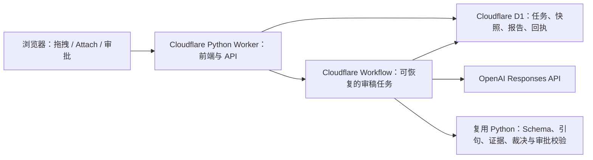

# 全云端运行手册

本机默认仓库知识库见 [knowledge.md](knowledge.md)。原生 Cloudflare Worker 无法
读取 Mac 上的 `private/knowledge/repos/` 或 SQLite，会在界面与报告中明确显示
本地默认来源不可用。部署不上传这些代码库、私有材料或索引；云端继续接受作者
明确提交的证据。需要自动使用本机默认来源时运行本地 CLI 或 Python Web 服务。

部署地址：**https://admissions-editor-cloud.jonas-aitherpath.workers.dev**。已于 2026-11-19 经用户明确授权完成模型与访问密码的 Secret 配置，现在使用 `private/web-password.txt` 中的正式密码登录；之前的 `private/cloud-qa-password.txt` 测试密码不再适用。

完整改稿已增加技术术语、方法、模型、指标、数据来源、库、组件及个人贡献的
提取和只读准确性核验。网页可选填术语表，随修改计划绑定；核验记录可下载为
`technical-context.json` 与 `technical-accuracy.json`。风险改写会保留上一安全
候选，提案另行记录。复用现有模型、D1 与 Workflow，无需新的 Key、外部 skill、
数据库迁移或额外模型阶段。旧版计划需重新准备，说明见
[technical-accuracy.md](technical-accuracy.md)。

当前 `gpt-6.1-terra` 已完成一份合成文书的真实云端验证：四位 Reviewer、两段裁决全部 complete，8 个分组完整裁决，审批新稿与回执下载通过。共 6 次模型请求，无重试。数据来源、样本量和 token 记录见 [validation.md](validation.md)。

旧地址 `admissions-editor-agent.jonas-aitherpath.workers.dev` 已通过 307 跳转到新地址；旧本机 Python 后端与 Tunnel 已停止，停止后再次通过全云端离线审稿、审批和下载验证。之前保存在本机 `runs/web/` 的历史材料未自动上传，仍可用本机 CLI 查阅。

前端托管、Python 后端、后台任务和持久数据都运行在用户自己的 Cloudflare 账号。电脑和终端关闭后，网站及已提交任务继续运行。前端使用原生 HTML/JavaScript 和简单 CSS，拖拽或 Attach 支持 PDF、Word `.docx`、UTF-8 `.txt` / `.md`；高级选项读取主张、来源 JSON。真实模型请求只在明确提交在线审稿时发生。

## 架构与数据



原生 Python Workers 以 WebAssembly 执行现有核心模块，使用平台 HTTP fetch 发出请求；无需容器、云主机或本机 Tunnel。Workflows 逐步持久化模型响应，再用冻结输入重放校验，复用已成功步骤；四个 Reviewer 的输入仍独立隔离。云端按角色顺序执行，保留各角色模型配置。模型错误按配置有限重试，Workflow 本身不额外重试付费步骤；进程重启不会让已完成步骤再次调用模型。

`src/admissions_editor/cloud_runtime.py` 复用现有审稿、裁决恢复、完整改稿和产物生成；本机 CLI 的多轮复审、初稿与评估继续可用。网页提供审稿、裁决重试、局部审批、完整改稿、全文接受和下载。页面 URL 的 `#run=<任务ID>` 或 `#revision=<任务ID>` 可用于刷新恢复对应任务，打开后仍需登录；不在浏览器存储稿件正文。对尚未返回且未持久化响应的中断请求，不承诺网络层恰好执行一次；不会通过 Workflow 自动重试付费请求掩盖这种不确定性。

D1 数据库名为 `admissions-editor`，绑定名 `DB`。实际数据库 ID、Worker URL/版本和 Workflow 名写在忽略 Git 的 `private/cloudflare-cloud.json`；模板用占位 ID，部署脚本生成 `cloudflare/wrangler.local.jsonc`。Schema 在 `cloudflare/migrations/0001_cloud.sql`；`0002_full_revision.sql` 增加审稿/全文改稿任务类型与父任务索引，不删除已有数据：

| 表 | 内容 |
| --- | --- |
| `jobs` | 冻结输入、角色配置、进度、父裁决运行引用 |
| `files` | 报告、run/snapshot/ledger/Diff、新稿与审批回执；大文本分块 |
| `sessions` | 访问会话的哈希与过期时间，不保存明文 Cookie |
| `login_limits` | 短期登录频率计数，客户端地址只保留哈希 |

审稿文件和完成状态通过 D1 事务批次一起发布；获批新稿和回执也在同一事务中写入。局部审批必须提供运行哈希、原稿哈希和具体修改 ID。完整改稿另外绑定逐条决定、作者事实、计划与候选哈希，核验通过后由作者接受全文。原文快照与旧结果保留；新稿单独保存。平台诊断在 `internal/`，网页下载只允许 `review/`、`revision/`、`outputs/`。真实稿件的失败诊断只记录异常类型与代码位置，不记录任意异常正文。

## 从仓库根目录安装和部署（macOS）

先按 README 安装 Python 3.11+ 的本地 `.venv`。部署另需 Node.js 22.13+；Python Workers 的 Python 3.14 和固定工具依赖由 setup 自动下载到隔离目录，不替换本机 Python。

```bash
npm ci
.venv/bin/python scripts/cloud_deploy.py setup
# 仅尚未登录 Cloudflare 时执行：
npx wrangler login
.venv/bin/python scripts/cloud_deploy.py init
.venv/bin/python scripts/cloud_deploy.py check
.venv/bin/python scripts/cloud_deploy.py deploy
```

`setup` 使用项目本地 uv 0.13.4，`cloudflare/uv.lock` 固定本机构建工具，`cloudflare/pylock.toml` 固定 WebAssembly 依赖及哈希。`init` 发现/创建数据库并应用迁移；不会自动升级 Cloudflare 套餐。资源用量遵循你账号现有的 Workers、Workflows 和 D1 套餐限制。

首次需配置云端 Secret，网页 API 才可登录，在线审稿才可调用模型。本机 `.env` 应包含真实 `OPENAI_API_KEY`、`OPENAI_MODEL`；网站密码读取已有 `private/web-password.txt`，若不存在会在本机生成。以下命令会把这三个值上传到你自己的 Cloudflare 加密 Secret，值通过 stdin 传递，不放进 shell 参数、源码、前端、日志或配置文件：

```bash
.venv/bin/python scripts/cloud_deploy.py secrets
```

本次敏感值上传已获明确授权并完成。你也可以在自己的终端直接执行此命令。更新 `.env` 或本机密码文件后，重复 `secrets` 即更新云端配置；不运行该命令则不会自动同步。

也可在 Cloudflare Dashboard → Workers & Pages → 对应 Worker → Settings → Variables and Secrets 手动添加加密 Secret：`OPENAI_API_KEY`、`OPENAI_MODEL`、`ADMISSIONS_WEB_PASSWORD`。密码至少 12 字符；不要使用占位值。在线供应商是 OpenAI，支持按 TOML 配置默认模型、角色覆盖、裁决模型、超时与重试。更改模型配置后部署：

```bash
.venv/bin/python scripts/cloud_deploy.py deploy --config private/models.toml
```

普通更新只需 `deploy`；新增迁移后先执行以下命令，不需要删除数据库：

```bash
.venv/bin/python scripts/cloud_deploy.py migrate
.venv/bin/python scripts/cloud_deploy.py deploy
```

以上命令执行完即可退出终端；没有需要保持运行的本机进程。旧的 `scripts/cloudflare.py up` 是可选 Tunnel 模式，不是全云端部署步骤。

## 登录与验收

网站会话有效期为 12 小时。过期、缺少 Cookie 或密码更新后的旧会话会令受保护
接口返回 401，发生在读取计划参数前；这与计划 Schema 或模型请求失败不同。
代码更新本身不会清除 D1 会话，网站密码改变会使旧 Cookie 失效。

前端收到 401 后显示醒目的重新登录框，保留原稿、选择、补充事实、答案、
术语表、写作样本及候选。正确登录后只刷新配置，不重新载入原稿或覆盖表单。
轮询与 Diff 的 GET 可以恢复；POST 不自动重发，须手动再次点击原操作，避免
重复生成或收费。输错密码仍保留内容；下载遇到 401 也不会跳离编辑页。
保留依赖于当前页面仍打开，勿在尚未提交材料时刷新或关闭。旧版已打开页面可
先在同一浏览器的新标签页登录首页，再回原页重试。

打开 `private/cloudflare-cloud.json` 中的 `url`。网页登录密码与 Secret `ADMISSIONS_WEB_PASSWORD` 一致，默认可用以下命令在本机查看：

```bash
open -e private/web-password.txt
```

先点“加载离线示例”再“开始审稿”，验证报告、勾选审批及新稿下载。这仍是云端 Worker/Workflow/D1 的真实执行，仅模型输出使用合成固定响应与规则裁决，不产生模型 API 请求。之后上传自有原稿、题目和证据，选择配置的模型并提交，才会产生真实模型费用。

自动化验证同样只使用合成示例：

```bash
.venv/bin/python -m unittest discover -s tests -v
npm run test:worker
npm run test:frontend
npm run test:documents
.venv/bin/python scripts/cloud_deploy.py check
.venv/bin/python scripts/cloud_revision_smoke.py \
  --url https://admissions-editor-cloud.jonas-aitherpath.workers.dev \
  --password-file private/web-password.txt \
  --out runs/verification/cloud-full-revision.json
.venv/bin/python scripts/cloud_smoke.py \
  --url https://YOUR_WORKER.YOUR_SUBDOMAIN.workers.dev \
  --password-file private/web-password.txt \
  --out runs/verification/cloud-native-e2e.json
```

输出摘要记录真实 HTTPS 登录、未授权 401、云端任务、审批及新稿/回执哈希验证，明确 `model_api_calls=0`。实际执行记录见 [validation.md](validation.md)。真实浏览器的拖拽、文件选择器和布局需要人工验收，DOM 测试不替代这些检查。

实际模型验证使用独立命令，会对一份仓库合成文书发出真实、计费的模型请求，通常为四角色与两段裁决共六次，暂时错误受已有配置的有限重试约束：

```bash
.venv/bin/python scripts/cloud_model_smoke.py \
  --url https://admissions-editor-cloud.jonas-aitherpath.workers.dev \
  --password-file private/web-password.txt \
  --out runs/verification/cloud-model-e2e.json
```

该命令先保存任务 ID，随后只轮询；摘要分别标记 `input_source=built_in_synthetic_draft`、`prediction_source=real_openai_cloud`、`sample_count=1` 和实际记录的调用次数。这是连通性与流程验证，不是模型质量评估。轮询中断时，读取摘要的 `job_id`，加 `--run <任务ID>` 可查看原任务，不会重复提交或新增审稿请求。也可直接打开网页的 `#run=<任务ID>` 查看。

## 配置清单

| 项目 | 必需或可选 | 用途 / 变量或文件 | 从哪里获取 | 如何验证 |
| --- | --- | --- | --- | --- |
| Cloudflare 账号 / OAuth | 部署必需 | Wrangler 本机登录 | 自己的 Cloudflare 账号，`npx wrangler login` | `init`/`deploy` 成功，记录 URL 与版本 |
| Python Worker | 必需 | `cloudflare/wrangler.jsonc`，入口 `python/entry.py` | 脚本部署，不需单独主机 | 网页与 `/api/session` 可访问 |
| D1 数据库 | 必需 | `DB`；迁移 `cloudflare/migrations/`；ID 在 `private/cloudflare-cloud.json` | `init` 自动创建，无数据库密码或连接 URL | 数据库迁移通过；审稿及回执在新会话中仍可读取 |
| 持久化后台任务 | 必需 | `REVIEWS`，Workflow 名由 Worker 名加 `-review` | `deploy` 自动创建 | `/api/reviews/{id}` 最终返回 complete/partial，刷新 URL 可恢复 |
| 模型供应商 | 在线必需 | OpenAI；固定出站 `POST https://api.openai.com/v1/responses` | 现有适配器 | 在线运行的角色及裁决结果 |
| API Key | 在线必需，已配置 | Cloudflare Secret `OPENAI_API_KEY`；来源为本机 `.env` | 自己的 OpenAI API 项目 | 本次已授权上传；`/api/config` 可用；实际模型命令验证 |
| 默认模型 / 角色选择 | 在线必需 | Secret `OPENAI_MODEL`；`examples/online.toml` / `private/models.toml` | 账号可用、支持 Structured Outputs 的模型 ID | `/api/config` 的 models；run.json 实际 provider |
| 完整改稿模型 | 在线改稿必需 | `[revision]` 默认；`[reviser]`、`[polisher]`、`[humanizer]`、`[revision_verifier]` 分别覆盖；缺省用 `OPENAI_MODEL` | 现有 OpenAI 项目与模型，不需要额外 Key | `/api/config` 的 configured_revision_available；revision.json 四阶段 provider |
| 编辑 Skills | 已随包配置 | `revision_prompts/manifest.json` 和四阶段提示；仓库 `.agents/skills/admissions-revision/` | 已检查的公共 MIT 来源，见 skills.md | `/api/skills` 或 `python -m admissions_editor.editorial_skills` |
| 访问密码 | 远程必需 | Secret `ADMISSIONS_WEB_PASSWORD`，本机 `private/web-password.txt` | 生成或自行指定，至少 12 字符 | 未登录返回 401，登录 Cookie 为 HttpOnly/Secure/SameSite |
| 项目 HTTP API | 已实现 | 与网页同源 `/api/session`、`/api/config`、`/api/demo`、`/api/reviews`、`/api/reviews/{id}`、`approve`、`retry-adjudication`、`files/...` | Worker URL 在状态文件 | `cloud_smoke.py` |
| 额外云主机 / R2 / Tunnel | 不需要 | 当前文本产物存 D1，无额外账号或常驻电脑 | 无 | 关闭本机后端后仍可完成云端离线示例 |
| 真实材料 / 人工标注 | 质量结论需要 | 作者素材、证据、独立标注，格式沿用现有 CLI | 作者与标注者 | 仍影响真实事实确认与质量指标，不阻塞云端运行 |

## 完整改稿操作与 API

点击“加载全文改稿示例”后提交离线审稿。结果中的修改区域已填入虚构作者的
决定和证据素材；检查理由与确认项后，准备计划、生成全文，查看完整候选、
全文 Diff、逐条建议追踪和核验结果。勾选已查看该版本的确认框，点击接受后
下载新稿及专用回执。未解决问题时只展示候选和阻塞项，不启用最终接受。
自有材料需先独立审稿，再由本人填写决定和事实；不会自动采纳全部意见。

全文改稿共四个模型步骤：实质改稿、润色、Humanizer、只读核验。
`[revision]` 默认 timeout=180、retries=1，四阶段可独立配置模型。
修改 `examples/online.toml` 后重部署；默认模型仍来自现有 Secret，无需再次上传密钥。
Workers/Workflow/D1 继续复用现有资源，应用提示及 MIT 许可随 Worker 打包，无额外服务。

| 端点 | 作用 |
| --- | --- |
| `GET /api/revision-demo` | 完整合成输入与示例作者决定，零 API 调用 |
| `GET /api/skills` | 当前四阶段提示版本、摘要与来源元数据 |
| `GET/POST /api/reviews/{id}/revision-plan` | 获取默认暂缓模板，或保存作者决定形成绑定计划 |
| `POST /api/reviews/{id}/revisions` | 提交 run_sha256 与计划，创建完整改稿任务 |
| `GET /api/revisions/{id}` | 进度、候选、核验、阻塞项、追踪与文件列表 |
| `GET /api/revisions/{id}/files/{path}` | 下载 candidate.txt、full.diff、trace.json、validation.json、stages/ 等 |
| `POST /api/revisions/{id}/finalize` | 用 candidate_sha256 与 plan_sha256 接受确切全文 |

所有端点沿用密码会话、同源检查与大小上限。最终接受返回独立下载路径，正文
与回执在 D1 同一事务发布；不会覆盖原稿或将完整改写伪装为原局部 CHG 审批。
`cloud_revision_smoke.py` 验证新云端流程、过期拒绝、最终稿和原文完整性，
数据为合成固定响应 n=1，model_api_calls=0；不能据此推算真实写作质量。

## 备份与本机离线入口

远程数据库备份包含输入正文和报告，需放在已忽略 Git 的私有目录：

```bash
npx wrangler d1 export DB --remote \
  --config cloudflare/wrangler.local.jsonc \
  --env-file cloudflare/.env.example \
  --output private/cloudflare-backup.sql
```

本机离线入口仍可用，不依赖云账号或模型密钥：

```bash
.venv/bin/admissions-editor serve --config examples/offline.toml --port 8788
# 打开 http://127.0.0.1:8788，加载内置离线示例。
```

Cloudflare 官方运行环境依据：[Python Workers](https://developers.cloudflare.com/workers/languages/python/)、[Python Workflows](https://developers.cloudflare.com/workflows/python/)、[D1](https://developers.cloudflare.com/d1/)。

## PDF / Word 文件解析

`npm ci` 安装固定版本的 PDF.js 6.5.438、Mammoth 1.13.0、fflate 0.8.3、esbuild 0.28.2，自动运行 `npm run build:web`。`web-src/document-worker.js` 为可维护源代码；构建产物在忽略 Git 的 `src/admissions_editor/web/vendor/`，包括 PDF Worker、中文 CMaps、标准字体和许可证，由本站静态资产提供，不访问第三方 CDN。Cloudflare 部署与可选 Tunnel 部署均自动构建；打包 Python wheel 前也应先构建。

原文件只在用户浏览器中解析，提取文字放入可编辑文本框，点击开始审稿后才作为已有 JSON 输入提交到 Worker/模型。D1 保存提取后的文字快照，不保存原始 PDF/DOCX 二进制；证据键保留原文件名。哈希和审批绑定提取并经作者确认的文本，输出新稿仍为 `.txt`，不保留原 Word/PDF 排版。

PDF/DOCX 原文件上限 10 MB、PDF 最多 50 页，提取文字上限 128 KB；解析 Worker 最多运行 45 秒。Word ZIP 先检查条目数、XML 与解压大小边界。解析期间暂停提交与旧结果审批；失败保留已有输入，多份证据在全部解析成功后一次性加入。页面仅展示纯文本，不插入文档生成的 HTML，不执行 PDF JavaScript或请求 Word 外部链接。

文本 PDF、中文、跨页内容和 DOCX 段落/表格均有真实解析测试。扫描件或仅含图片的文件无 OCR，空白文本会提示先文字识别；部分 PDF 页面无文字时显示页码供核对。旧 `.doc`、加密或损坏文件会给出转换/解密提示。复杂 PDF 阅读顺序、图片、批注和版式需要作者核对，不能把未提取的内容视为已审阅。

合成样例在 `examples/documents/`，可直接拖入网页。`npm run examples:documents` 可重建；`npm run test:documents` 运行真实 PDF/DOCX 解析与打包 Worker 协议测试，`npm run test:frontend` 检查拖拽、Attach、失败不覆盖旧输入、批量原子提交和审批失效状态。
